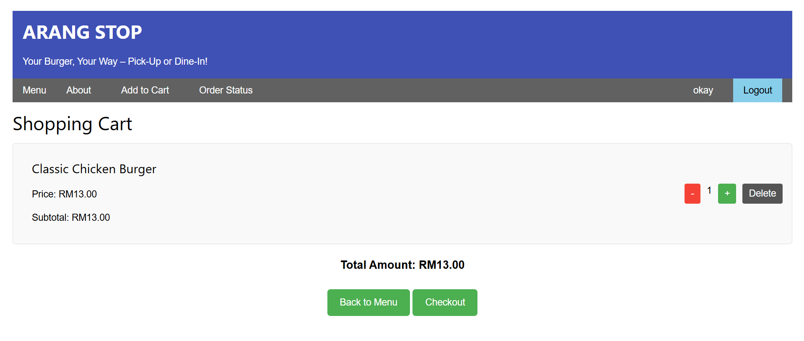

# Arang Stop – Web-Based Food Ordering & Cashier System

## Project Overview

Arang Stop is a web-based food ordering and cashier system developed to simplify the ordering process for both customers and restaurant staff.

The system allows customers to browse the food menu, add products to their shopping cart, and place orders for dine-in or pick-up. Staff members can manage incoming orders, process payments, and generate receipts through a dedicated cashier interface.

This project demonstrates my practical experience in full-stack web development, database integration, user authentication, and transaction management.

## Live Demo

**Website:** [Visit Arang Stop](https://arangstop.site.je)

> **Note:** This website is hosted on InfinityFree for portfolio and demonstration purposes. The live demo may become temporarily or permanently unavailable in the future due to hosting limitations or changes. The project source code remains available in this repository.

## Project Objectives

- Digitize the traditional food ordering process.
- Provide a convenient ordering experience for customers.
- Simplify order and payment management for restaurant staff.
- Reduce manual work through a centralized ordering system.
- Apply full-stack web development concepts to a practical business scenario.

## Key Features

### Customer Module

- Customer registration and login
- Browse food products and prices
- Add products to the shopping cart
- Manage selected items and quantities
- Select dine-in or pick-up options
- Checkout and place orders

### Staff & Cashier Module

- Staff authentication
- View and manage customer orders
- Process customer payments
- Manage cashier operations
- Generate order receipts

## System Workflow

1. Customers browse the available food menu.
2. Selected products are added to the shopping cart.
3. Customers review their orders and proceed to checkout.
4. Order information is recorded in the database.
5. Staff members manage orders through the cashier interface.
6. Payments are processed and receipts are generated.

## Technology Stack

| Technology | Purpose |
| --- | --- |
| PHP | Server-side development and business logic |
| MySQL | Database management and data storage |
| HTML5 | Website structure |
| CSS3 | Interface styling and layout |
| JavaScript | Client-side functionality |
| W3.CSS | Responsive interface styling |
| FPDF | PDF receipt generation |
| InfinityFree | Web hosting and deployment |

## Technical Skills Demonstrated

- Full-stack web application development
- Relational database management
- Frontend and backend integration
- CRUD operations
- User authentication and session management
- Shopping cart and checkout implementation
- Order and payment management
- PDF receipt generation
- Responsive web interface development
- Website deployment and hosting configuration
- Debugging and troubleshooting

## System Screenshots

### Food Menu

### Shopping Cart

### Staff Dashboard

## Demo Account

The same demo account can be used to access both the Customer and Staff interfaces.

| Login Details | Credentials |
| --- | --- |
| Username | customer |
| Password | customer123 |
| Accessible Modules | Customer & Staff |

Visitors may also register a new account to explore the system.

> **Note:** The current system shares authentication between customer and staff accounts without proper role-based access control. This is a known limitation, which is explained in the Known Limitations & Learning Outcomes section below.

## Known Limitations & Learning Outcomes

During the development of this project, I did not implement proper role-based access control (RBAC) to separate customer and staff permissions. As a result, registered customers may also be able to access staff functionality using their existing login credentials.

After reviewing my implementation, I recognized that this was a security oversight on my part, as unauthorized users could potentially access restricted staff operations.

This experience helped me understand the importance of:

- Role-based access control (RBAC)
- Proper authentication and authorization
- Separation of user roles and permissions
- Server-side access validation
- Secure application development practices

In future projects, I will prioritize implementing proper access control and permission validation to prevent unauthorized access to restricted functionality.

As this was an academic project developed in 2024, it also serves as a reference for my learning progress and continuous improvement as a software developer.

## Demo Video

[Watch System Demonstration](https://youtube.com/your-demo-video)

## Local Installation

To run this project on your local machine:

1. Download or clone this repository.
2. Install XAMPP or another PHP and MySQL development environment.
3. Place the project folder inside the `htdocs` directory.
4. Start Apache and MySQL.
5. Create a database using phpMyAdmin.
6. Import the provided SQL database file.
7. Configure the database connection in `connection.php`.
8. Open the project through your browser.

Example:

`http://localhost/arang_stop/`

## Future Improvements

- Integration with an online payment gateway
- Improved sales reporting and analytics
- Real-time order status notifications
- Product inventory management
- Enhanced user interface and mobile experience
- Additional security improvements

## Project Information

- **Project Name:** Arang Stop Ordering System
- **Project Type:** Academic Web Application Project
- **Year:** 2024
- **Category:** Full-Stack Web Development
- **Development Scope:** Frontend, Backend and Database

## Developer

Developed as part of a Web Application course project.

This project reflects my interest in building functional web applications that address practical business needs, from developing the user interface and backend functionality to database integration and online deployment.

Thank you for taking the time to explore this project!
